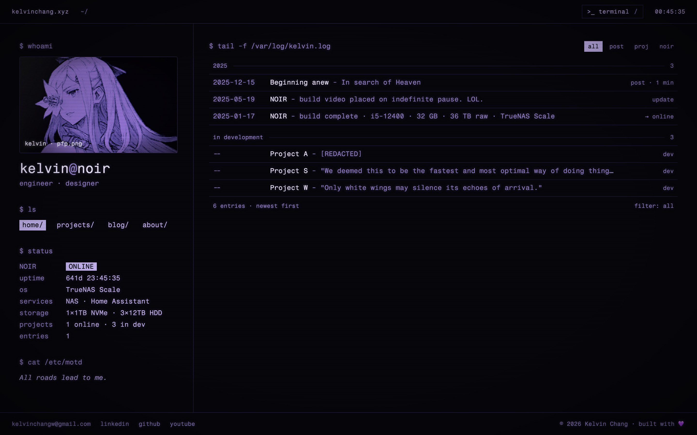
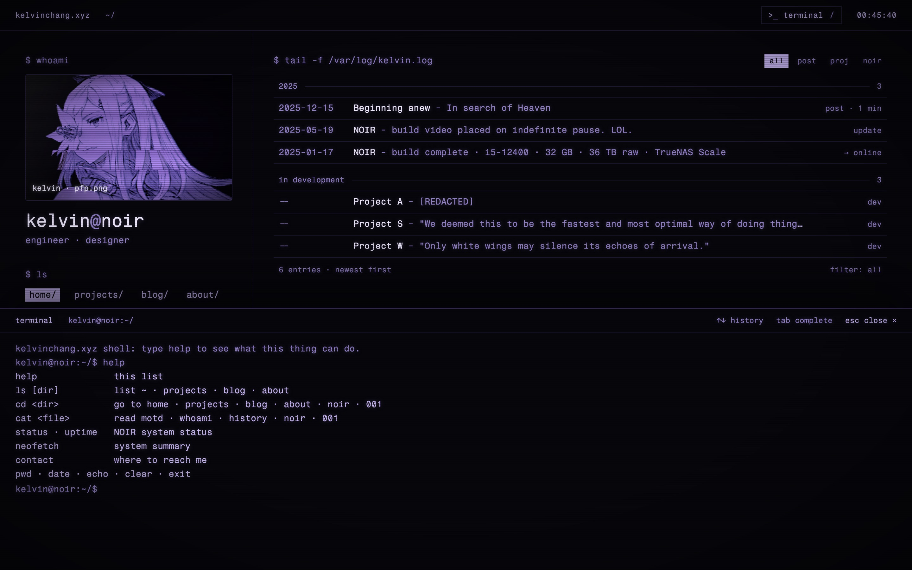

<div align="center">
    
    <h1>kelvinchang.xyz</h1>
    <p>Personal site of Kelvin Chang, built as a violet phosphor CRT terminal.</p>
    <p><a href="https://kelvinchang.xyz">kelvinchang.xyz</a></p>
</div>



## What is on it

Every page sits inside the same frame:

- **Title bar**: the host, the current shell path (`~/projects/noir`), the `>_ terminal` toggle and a live clock.
- **Rail**: `$ whoami` with the animated CRT portrait, `$ ls` nav, a hand-written `$ status` for the NOIR home server (state, uptime, OS, services, storage and counts) and `$ cat /etc/motd`.
- **Terminal drawer**: a small shell over the site, described below.
- **Overlays and footer**: full-viewport scanlines, a vignette, and contact links.

| Path | Page |
| --- | --- |
| `/` | `tail -f /var/log/kelvin.log`: posts and project updates, filterable by `post`, `proj` and `noir` |
| `/projects` | `ls -la ~/projects`: the projects table |
| `/projects/project-noir` | the Project NOIR write-up |
| `/blog` | `ls -la ~/blog` and a `head` of the newest post |
| `/blog/001` | post 001 |
| `/about` | `cat ~/about/whoami` and `~/about/history` |
| anything else | a 404 that reads like a missing file |

## The terminal



Press `/` or `` ` `` anywhere outside a text field, or click `>_ terminal`. The command input takes focus on open. `Esc` or `exit` closes the drawer and moves focus to the toggle, unless a link or button outside the drawer already has focus. `Tab` completes a command name, `Up` and `Down` walk the command history, and the scrollback survives closing the drawer; `MAX_SCROLLBACK` caps it and `clear` empties it.

| Command | What it does |
| --- | --- |
| `help` | prints the hand-written `HELP_LINES` summary, which does not list the `open` or `whoami` commands |
| `ls [dir]` | lists `~`, `projects`, `blog` or `about` |
| `cd <dir>`, `open <dir>` | goes to `home`, `projects`, `blog`, `about`, `noir` or `001` (`..` and no argument go home; `a`, `s` and `w` land on projects) |
| `cat <file>` | prints `motd`, `whoami`, `history`, `noir` or `001` |
| `status`, `uptime`, `neofetch` | NOIR system status, uptime since its build day, and a system summary |
| `contact` | email, LinkedIn, GitHub and YouTube |
| `whoami`, `pwd`, `date`, `echo`, `clear`, `exit` | what you would expect |

Command names are case-insensitive, and so is the argument to `ls`, `cd`, `open` and `cat`. That argument may carry a leading `~/`, a trailing `/` or a lowercase `.md` suffix, so `cat ~/001.md` works, but paths do not nest: `cat ~/blog/001.md` is a missing file. `echo` prints its arguments joined by single spaces, case kept. Unknown commands print `command not found` and point at `help`. The interpreter is a pure function in `src/lib/terminal.ts`; the "filesystem" it reads is data in `src/data/site.ts`.

## Stack

- [Vite](https://vite.dev), React and TypeScript in strict mode (versions in `package.json`)
- [React Router](https://reactrouter.com) with case-sensitive routes
- CSS Modules, with the palette, glow and layout tokens in `src/styles/variables.css`; font sizes are plain px values in `global.css` and each module
- [Fragment Mono](https://fonts.google.com/specimen/Fragment+Mono), self-hosted through `@fontsource/fragment-mono`
- [Lenis](https://lenis.darkroom.engineering) smooth scrolling
- Vitest, jsdom and Testing Library
- Deployed on Vercel as a single-page app (`vercel.json` rewrites every path to `index.html`)

Fonts and images ship with the build, so the site makes no requests to third-party hosts at runtime.

## Development

Node 22.13 or newer (the minimum for pnpm 11) and pnpm 11. If pnpm is not installed, run the same commands through `npx -y pnpm@11`.

```sh
pnpm install
pnpm dev          # http://localhost:5173
pnpm test         # vitest run
pnpm test:watch
pnpm lint         # eslint .
pnpm build        # tsc -b && vite build, output in dist/
pnpm preview      # serves dist/ on http://localhost:4173
```

Vercel builds `main`, so a push to `main` is a release. Nothing runs the tests before that (no CI, no hooks), so run `pnpm lint` and `pnpm test` first.

## Layout

```
src/
    main.tsx          fonts, global styles, React root
    App.tsx           route table (AppRoutes) and the Lenis hook
    settings.ts       site-wide CRT toggles: scanlines, portrait motion
    data/site.ts      most copy and data: routes, nav, log, projects, posts, NOIR summary, terminal filesystem
    lib/              pure helpers: terminal interpreter, route resolution, log grouping, time, cx
    hooks/            useTerminal, useLenis, useNow, usePrefersReducedMotion
    components/       Shell (frame and shortcuts), TitleBar, Rail, CrtMonitor, Terminal, Overlays, Footer, ui, TitleManager
    pages/            Home, Projects, Projects/ProjectNoir, Blog, Blog/001, About, NotFound
    styles/           reset, variables (tokens), global
    test/             vitest setup, fake clock, matchMedia stub
```

Tests sit next to the code they cover (`*.test.ts`, `*.test.tsx`).

## Editing content

Most copy lives in `src/data/site.ts`: routes, nav, the log, projects, posts, the NOIR summary and the terminal's files and directories. The rest is inline: each page's `$` prompts, table headers and captions; the body paragraphs of the NOIR write-up in `src/pages/Projects/ProjectNoir/ProjectNoir.tsx`; the terminal's banner, `help` text, `status` rows and `whoami` line in `src/lib/terminal.ts`; the tab titles in `src/components/TitleManager.tsx`; and the 404 and footer text in their components.

The tests pin today's content (dates, counts, titles, status rows, NOIR as the only online project), so a content change is expected to turn `site.test.ts`, `terminal.test.ts`, the page tests and the component tests that render the same copy red (`Rail.test.tsx` for the status rows, `Footer.test.tsx` for the contact links). Two fixtures can break too: `routes.test.ts` uses `/blog/002` as its unknown path, and `log.test.ts` expects its fixture to cover every group in `LOG_GROUP_ORDER`. Update them in the same commit.

- **Separators.** Titles and subtitles join with `SEP` (" - "), and projects still in development show `NO_DATE` ("--") in date columns. Copy contains no em dashes, and the tests enforce it: `site.test.ts` checks every string `site.ts` exports, `terminal.test.ts` checks every command's output, and the Home, Projects, NOIR, Blog, 001 and About page tests check their rendered text (the 404 page, footer, title bar, drawer header and tab titles are not checked). The tests also spell out " - " and "--", so changing either constant means updating them as well.
- **A new post.** Add a `RouteKey` with its `ROUTE_PATHS`, `SHELL_PATHS` and `ROUTE_SECTIONS` entries. Put the post at the front of `POSTS` (newest first) and a row at the front of `LOG`, adding its year to the front of `LOG_GROUP_ORDER` if it is new, because the home log drops rows whose group is not listed. Copy `src/pages/Blog/001/` for the page: in the copy, change the id passed to `postById` and the header image import (add the image under `src/assets/images/`), and in the copied test point both `./001` imports at the new file and give its find-by-id case a fake id other than the new post's. Register the route in `src/App.tsx` with `caseSensitive`. Then add the post to `TERMINAL_FILES` (`cat`) and `CD_TARGETS` (`cd`), as the first line of `TERMINAL_DIRS.blog` (`ls`), and to the `cd` and `cat` lines of `HELP_LINES`; and bump `entries` in both `STATUS_STATIC` and `statusLines`.
- **Projects.** `PROJECTS` drives the projects table. `NOIR` holds the write-up's data (intro, specs, running services, dates and the update note); its body paragraphs are JSX in `ProjectNoir.tsx`. The home log rows, including the in-development group, are separate entries in `LOG`.
- **NOIR facts.** The server's facts are typed in several places and nothing checks them against each other: `STATUS_STATIC` (rail), `statusLines` in `src/lib/terminal.ts` (terminal `status`, worded differently), `NEOFETCH_STATIC` (`neofetch`), `NOIR.specs` and `NOIR.running` (write-up), and the `ONLINE` state in `NOIR.state`, `Rail.tsx` and `statusLines`. Change them together.
- **Uptime.** Counts from `UPTIME_SINCE_MS` in `src/lib/time.ts`: local midnight on 2025-01-17, NOIR's build day. `UPTIME_SINCE_LABEL` is the same date as text, printed by `uptime`. The tests require it to match `UPTIME_SINCE_MS` and `NOIR.buildDate`, and require `NOIR.buildDate` to match NOIR's `since` in `PROJECTS` and the date of its build row in `LOG`, so change all five together.
- **CRT settings.** `src/settings.ts` turns the scanline overlay and the portrait animation on or off. There is no UI for it yet.

## Behaviour worth knowing

- Routes are case-sensitive, like Unix paths: `/projects` works and `/Projects` renders the 404 page (with HTTP 200, since `vercel.json` rewrites every path to `index.html`). Trailing slashes are fine.
- Every link or `cd` navigation, even to the page already on screen, scrolls to the top (through Lenis when it is running), so an in-flight smooth scroll cannot override it. Back and forward keep the position the browser restores.
- Under `prefers-reduced-motion` there is no Lenis (native scrolling) and the CRT portrait is a still frame with no power-on sequence.
- The terminal output is a polite `role="log"` live region. Shortcuts ignore Ctrl, Alt and Meta combinations (not Shift) and keys sent during IME composition, and `Shift+Tab` leaves the command input for the close button.
- Below 1024px the rail stacks above the content. The design was made for desktop, so the small-screen layout is a best effort that avoids horizontal overflow down to 320px.

## Design

The look comes from the "Terminal" project in [Claude Design](https://claude.ai/design/p/2b3f27ac-810c-4a59-a841-7e0ec53aaf04?file=Terminal.dc.html) (private to the owner). `Terminal.dc.html` is the source of truth; the handoff's README is older and loses where they differ. It gives a violet phosphor palette, Fragment Mono, a centred frame up to 1440px wide with a 400px rail, and the CRT portrait built from blended layers over one grayscale image (vertical-hold roll, glitch slices, chroma split, violet tint, scanlines, grain, flicker and glass). The tokens are in `src/styles/variables.css`.

Deliberate departures from the design:

- No em dashes: `SEP` and `NO_DATE` replace the design's dash separators, and the terminal banner's dash became a colon.
- The title bar shows no uptime readout; the rail's `$ status` already has it.
- The music section (a `$ cat ~/music/on-record` block on the home page and a player on About) is left out until the music is finalised. The `*-cover.jpg` files in `src/assets/images/` are kept for it, and `site.test.ts`, `terminal.test.ts`, `Home.test.tsx` and `About.test.tsx` currently assert that it is absent.
- No mobile design yet; the small-screen layout above is a stopgap.
